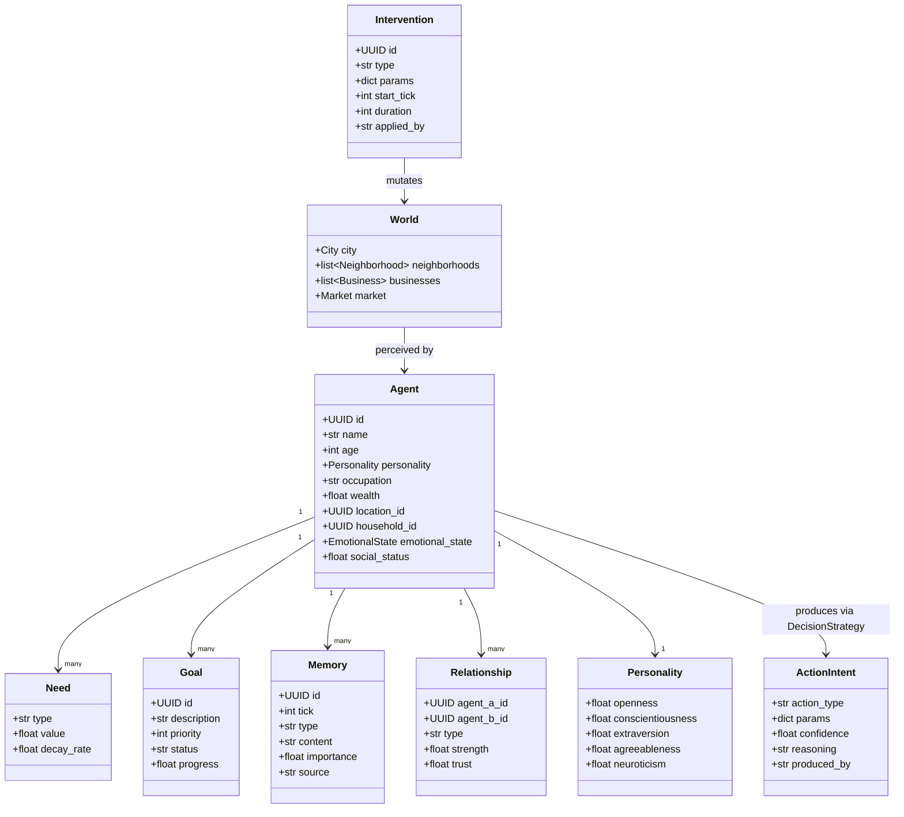
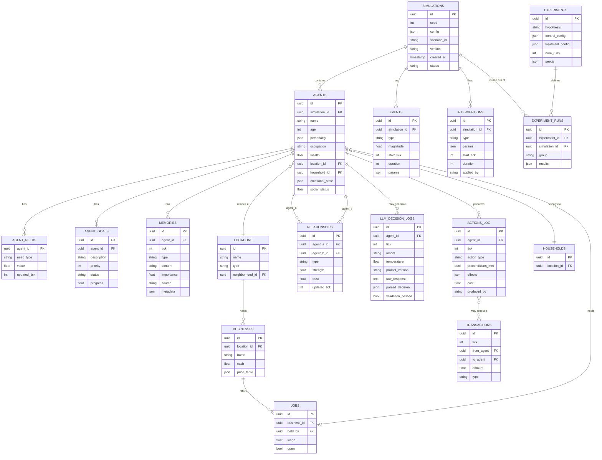
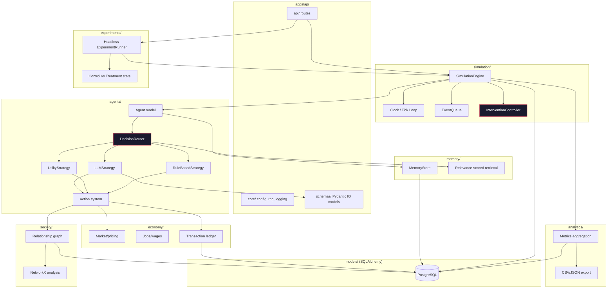
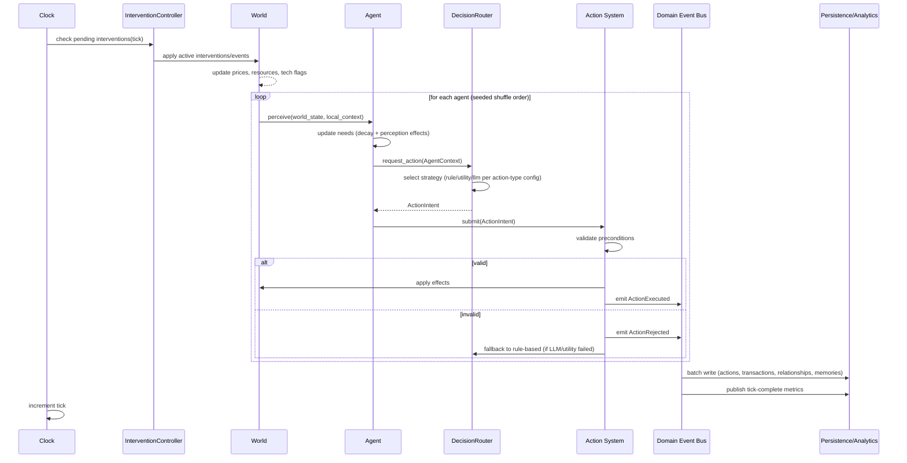
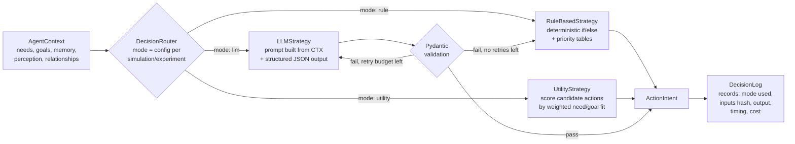

# ECHO — Finalized Architecture (Pre-Code)

Status: Approved direction, incorporating Researcher/God Mode, tri-modal decision system, and locked MVP scope.

---

## 1. Design Principles (locked)

1. **One agent interface, three decision backends.** Rule-Based, Utility-Based, and LLM-Assisted must be interchangeable strategies behind the same `DecisionStrategy` contract — same inputs (`AgentContext`), same output (`ActionIntent`). This is what makes RQ5 (rule-based vs. LLM trade-offs) an actual experiment instead of an apples-to-oranges comparison.
2. **God Mode is an intervention layer, not a bypass.** It changes the *environment* (prices, taxes, resource availability, tech unlocks, information injections) — never an individual agent's internal state or decision directly. This preserves the "events shape environment, agents decide" rule from the original spec.
3. **Everything MVP-scoped is a real slice, not a stub dressed as a feature.** If it's out of scope, it's out — documented as future work, not half-built.

---

## 2. Domain Model

---

## 3. Database ER Diagram

**Note on Intervention vs. Events:** both mutate world state through the same `WorldMutation` mechanism. `EVENTS` are scenario-scripted (defined ahead of time, part of a scenario config); `INTERVENTIONS` are researcher-triggered at runtime via God Mode. Keeping them as separate tables (rather than collapsing into one) preserves a clean audit trail of "what was planned" vs. "what the researcher did live" — this matters for reproducibility reporting.

---

## 4. Module Dependency Diagram

Key dependency rule: **`agents/` never imports from `apps/api/routes`.** The simulation core must be runnable as a plain Python library from a script (needed for headless experiments running 10–30 sims without going through HTTP). FastAPI is a thin consumer of `simulation/`, not the other way around.

---

## 5. Simulation Tick Lifecycle

Notes:
- Agent iteration order is **seeded-shuffled per tick**, not fixed, to avoid systematic first-mover advantage — but the shuffle itself is deterministic given the seed.
- Inter-agent effects (e.g., a transaction touching two agents) are queued during the agent loop and resolved in a single batch pass immediately after, to avoid order-dependent double effects.
- Persistence is async/batched, not per-action, to protect write throughput (Risk 5 from the original review).

---

## 6. Decision Pipeline (tri-modal, experimentally comparable)

**Why this matters for the research questions:** because all three strategies consume the identical `AgentContext` and emit the identical `ActionIntent` schema, an experiment can run the *same scenario, same seed, same population* three times — once per mode — and the only variable is decision-making logic. That's what makes RQ5 a real controlled comparison instead of a vibes-based claim.

**Mode selection granularity:** configurable per action-type, not just globally. Simple actions (`move`, `eat`) can be forced to `rule` regardless of the simulation's default mode, so an "LLM-Assisted" experiment run doesn't burn API calls on trivial actions — it means "LLM available for ambiguous/high-stakes actions," matching Section 10/29 of your original spec (cost control).

---

## 7. God Mode / Researcher Intervention Layer (architecture only, no UI yet)

`InterventionController` sits between the API layer and `World`. It exposes a small, explicit set of intervention types — it does **not** allow arbitrary state writes:

- `PriceShock(target: str, multiplier: float, start_tick, duration)`
- `TaxPolicy(rate: float, applies_to: str, start_tick, duration)`
- `ResourceShortage(resource_type: str, availability_multiplier: float, start_tick, duration)`
- `TechnologyIntroduction(tech_id: str, effect_params: dict, start_tick)`
- `InformationInjection(content: str, credibility: float, seed_agents: list[UUID], start_tick)` *(stubbed interface only — real propagation is out of MVP scope, but the intervention type is reserved now so the schema doesn't need breaking changes later)*

Each intervention is logged to `INTERVENTIONS` with `applied_by` (researcher/system) for the audit trail. Interventions go through the **same `WorldMutation` application path** as scripted `EVENTS` — this is the guardrail that stops God Mode from becoming a backdoor that bypasses the "environment changes, agents decide" rule.

No UI, no auth model, no endpoint wiring yet — just the controller class, the intervention type registry, and the DB table. This is intentionally sequenced into Phase 8 (Events), not Phase 0.

---

## 8. Finalized MVP Scope

**In:**
100 agents · 1 city · 5 neighborhoods · needs · goals · short/long-term memory (no embeddings) · basic relationships · basic economy (jobs, wages, spending, simple pricing) · rule-based decisions fully working · utility-based decisions fully working · LLM-assisted decisions wired with real provider calls but limited to a small, configurable set of action types · God Mode backend (controller + intervention types + logging), no UI · one working headless experiment (**Memory Impact**, control = memory disabled vs treatment = memory enabled) · Postgres persistence · plain functional dashboard (status, start/pause/step, agent list, one agent profile view).

**Out (explicitly, documented as future work):**
pgvector/semantic memory · information propagation system · multi-city/migration · full experiment UI (headless/script-driven only) · God Mode UI · world map visualization · advanced network topology comparisons · notification/auth system beyond basic protection.

---

## 9. Phase 0 — Exact Implementation Plan

Phase 0 produces **structure and contracts, zero business logic**, so that every later phase has a stable interface to build against.

**Deliverables:**

1. **Monorepo scaffold** — `apps/api`, `apps/web`, `simulation/`, `docs/`, `scripts/`, `docker-compose.yml`, `.env.example`, `README.md` skeleton per the original repo structure.
2. **`docker-compose.yml`** — Postgres + Redis services, no app containers yet (run API/web locally against composed services during dev).
3. **`apps/api/app/core/`** — config loader (env-based), structured logging setup, and the **single seeded RNG provider** (`core/rng.py`) that every future random call in `simulation/` and `agents/` must go through. This is the reproducibility root — establishing it in Phase 0 means nothing downstream can quietly introduce an unseeded `random.random()`.
4. **`apps/api/app/schemas/`** — Pydantic contracts only, no implementations: `AgentContext`, `ActionIntent`, `DecisionStrategy` (protocol/ABC), `WorldMutation`, `Intervention` base + the five intervention types listed in Section 7. These are the interfaces every later phase implements against.
5. **`simulation/` package skeleton** — `SimulationEngine`, `Clock`, `EventQueue`, `InterventionController` as empty classes with method signatures and docstrings only (`start()`, `pause()`, `resume()`, `step()`, `stop()`, `reset()`) — no tick logic yet.
6. **Alembic setup** — initial migration containing only `simulations` and a placeholder `agents` table (enough to prove the DB pipeline works end-to-end), not the full ER diagram yet — that's Phase 1.
7. **`apps/web` skeleton** — Next.js app with route groups matching the nav, each route rendering a placeholder "Phase N" page. No data fetching yet.
8. **Test harness** — pytest configured, one smoke test that boots `SimulationEngine`, calls `reset()`/`step()` on the empty skeleton, and asserts it doesn't throw. This proves the CI/test pipeline works before there's anything real to test.
9. **`docs/architecture.md`** — this document, committed as the source of truth, versioned going forward.

**Explicitly not in Phase 0:** no agent logic, no decision strategies implemented, no DB writes beyond the placeholder migration, no frontend data, no LLM provider calls.

**Definition of done for Phase 0:** `docker-compose up` brings up Postgres/Redis, `alembic upgrade head` runs cleanly, the smoke test passes, and `apps/web` renders its placeholder nav locally. Nothing simulates anything yet — that's Phase 2+.

---

## 10. Remaining Architectural Risks (3–4 month solo/small-team timeline)

1. **LLM strategy becomes a time sink disproportionate to its grading weight.** Wiring a real provider, validation, retries, and fallback for even a limited action set is a multi-day task on its own. Mitigate by scoping LLM-assisted mode to 2–3 action types max for MVP (e.g., `quit_job`, `major_relationship_decision`) — enough to make the tri-modal comparison real without it swallowing the schedule.
2. **Utility-Based mode needs tuning time you may not budget for.** Rule-based is easy to get "working," LLM-based is impressive but bounded in scope; Utility-based is the one that silently needs the most iteration to produce sensible behavior (weight tuning against sanity scenarios). Don't leave it as an afterthought between the other two — schedule explicit tuning time in Phase 4.
3. **God Mode's five intervention types risk becoming five mini-features instead of one mechanism.** Keep them thin wrappers over one `WorldMutation` applier; if any single intervention type needs bespoke logic beyond "adjust a world parameter over a tick range," that's a sign it's scope creep for MVP.
4. **Three-way experiment comparison multiplies your run count.** Memory Impact experiment × 3 decision modes × N seeds for statistical validity could mean 60–90 simulation runs before you have anything to report. Decide early how many seeds is "enough to be honest but affordable" (5–10 is defensible for a final-year project if you say so explicitly in methodology, rather than promising 30 and running out of time).
5. **Solo/small-team context switching cost.** This architecture spans backend simulation, DB design, LLM integration, and frontend — each a real skill area. The phase-gate approval process you already required (Section 40 of your original spec) is the right mitigation; resist the urge to parallelize phases to "save time," since that's exactly where architectural drift and rework creep in.
6. **Examiner-facing risk, not technical:** if the LLM-assisted mode is scoped very small (item 1 above), be ready to explain *why* in your defense — frame it as a deliberate cost-control and reproducibility decision (which it genuinely is), not a shortcut. This is a stronger academic position than an over-scoped LLM layer that's flaky under examination.

---

**Next step (on your approval):** scaffold Phase 0 exactly as specified in Section 9 — structure, contracts, empty classes, one smoke test. No simulation logic.
